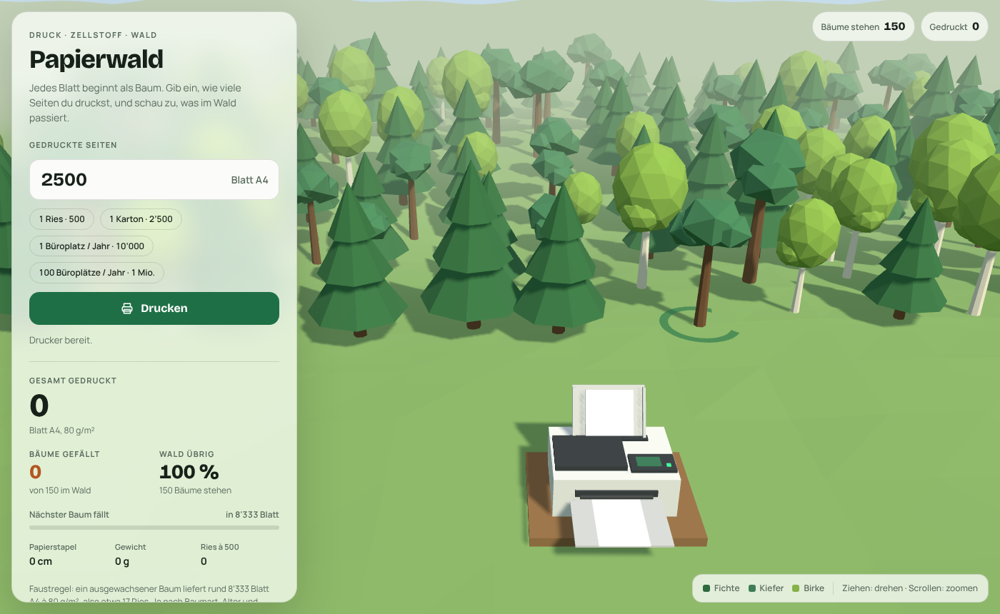
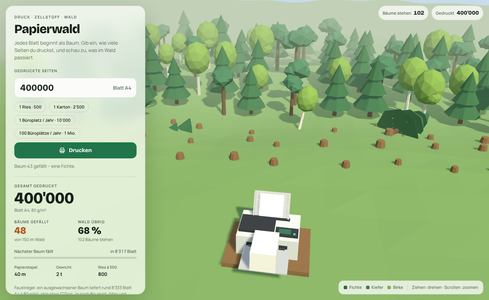
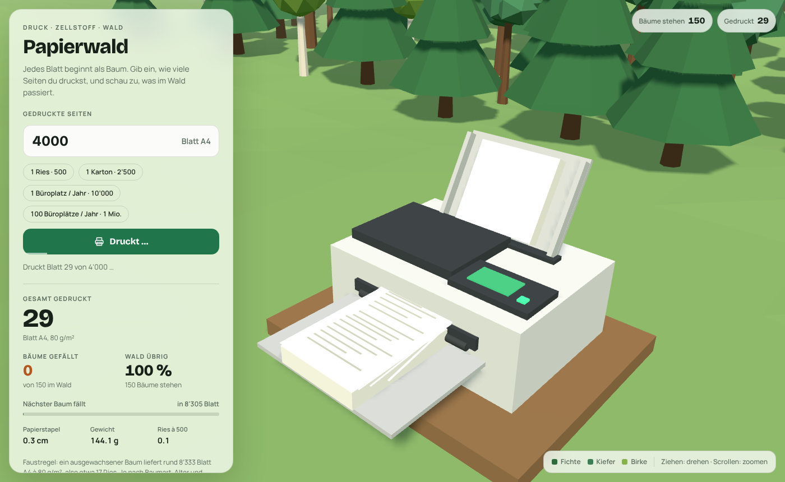
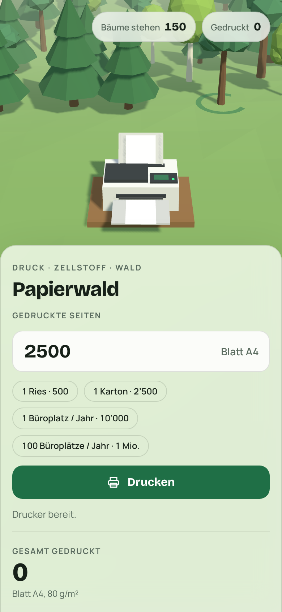

# Papierwald (Paper Forest)

[Deutsch](README.md) | **English**

An interactive 3D visualization of how much forest printed paper costs.
A low-poly forest of 150 trees (spruce, pine, birch) with an animated printer in front.
For every started **8,333 sheets of A4 (80 g/m²)** one tree is felled, and the forest
visibly recedes. The user interface of the app is in German.

## Screenshots

*Start view: 150 trees, the next one to fall is marked by a green ring, printer ready.*

*After 400,000 sheets: 48 trees felled, 68 % of the forest left, stumps remain.*

*The printer with input tray, control panel and a growing stack of paper.*

*On a phone the controls become a bottom sheet below the 3D view.*

## Getting started

There is no build step. The whole application is a single file: `index.html`.

- Locally: open `index.html` in a browser (an internet connection is required because
  Three.js and the fonts are loaded from CDNs).
- GitHub Pages: repository settings → Pages → branch `main`, folder `/ (root)`.
  The site is then available at `https://<user>.github.io/<repo>/`.

## Usage

- Enter a number of pages and click **Drucken** (Print), or pick a preset chip
  (1 ream · 500, 1 carton · 2,500, 1 office workplace / year · 10,000,
  100 office workplaces / year · 1 million).
  Print jobs accumulate until **Wald aufforsten** (Reforest) resets everything.
- 3D view: drag to rotate the camera, mouse wheel or pinch to zoom.
- The panel shows total sheets printed, trees felled, remaining forest, progress to the
  next tree (marked in the forest by a pulsing ring), stack height, weight and number of
  reams. If a job exceeds the forest, the result is converted into "forests of this size".

## Assumptions

| Quantity | Value |
| --- | --- |
| Sheets per tree | 8,333 (rule of thumb, about 17 reams) |
| Weight per sheet | 5 g (A4, 80 g/m²) |
| Thickness per sheet | 0.1 mm (500 sheets ≈ 5 cm) |
| Trees in the forest | 150 |

The "sheets per tree" figure varies widely with tree species, age and pulping process;
recycled fibers are not taken into account. The constants are defined at the top of the
script in `index.html` (`SHEETS_PER_TREE`, `TREE_COUNT`) and can be adjusted there.

## Tech

- [Three.js r128](https://threejs.org/) via cdnjs (WebGL, shadows, fog)
- Fonts "Bricolage Grotesque" and "Manrope" via Google Fonts
- Plain HTML/CSS/JS, nothing to install
